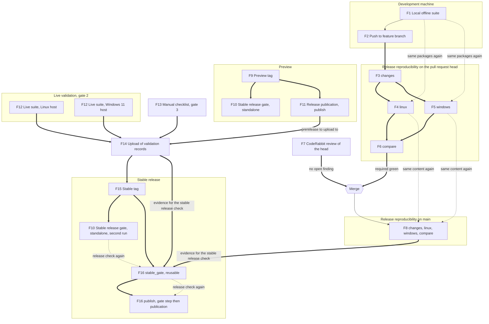

# Feedback time of offline, Blacksmith CI, and live validation

This document is the analysis requested by [issue #171](https://github.com/grauzone-labs/sandboxed-agents/issues/171). It maps the validation flow from a pushed commit to a merged pull request, a preview, and a stable release. It sets a per-stage timing baseline for three paths: offline validation, GitHub CI on Blacksmith runners, and live validation on the project's Linux and Windows 11 hosts. It then names the critical path, the duplicated and serial work, a ranked list of optimization options, and drafts of follow-up tasks.

The revision analysed is `df15009518019a15115b4b7a5b03696aec4cf1f5` (`main`). Data was collected on 2026-11-18 UTC. All times are seconds unless marked. "n" is the sample size. An observation with fewer than two comparable samples is marked "single sample".

**Headline.** Take one clean pass from the first push to a stable release, with the stages added one after another. Measured machine time is 4,781.72 seconds:

| Path | Seconds | Share |
| --- | ---: | ---: |
| Offline validation (local) | 269 | 5.6 % |
| GitHub CI (pull request run + push run) | 1,141 | 23.9 % |
| Live validation (Windows host, the longer one) | 3,121.72 | 65.3 % |
| Tag workflows (preview + stable publication) | 250 | 5.2 % |

The critical stage differs by path (section 4):

- To merge, it is the GitHub CI run, median 580. Inside it the `windows` job ended later than the `linux` job in 40 of 48 runs. The CI run was longer than the CodeRabbit review in 26 of 30 measured heads.
- To a validated preview, it is the live suite on the Windows host (median 3,121.72, n = 5), against Linux (median 1,411.44, n = 6).
- To a stable release, it is the preview path plus the stable tag's `Release publication` run, 161 (single sample).

The share figures model one clean pass. Real changes repeat stages (sections 3.2 and 3.3), and the manual checklist and all human waiting are unmeasured and excluded.

**What was not done.** No optimization was implemented. No workflow, test, gate, schema 2 record, release check, cancellation behaviour, or live-validation rule was changed. No live run was started and no live host was contacted; every live number comes from records already in the repository. No follow-up issue was filed; the drafts in section 7 are text only.

## 1. Sources and method

| Id | Source | How read |
| --- | --- | --- |
| S-CI | GitHub Actions REST `GET /repos/grauzone-labs/sandboxed-agents/actions/workflows/release-reproducibility.yml/runs?per_page=60`, and `GET .../actions/runs/{run_id}/jobs` for each of those 60 runs (ids 42287506493 to 44382577916, created 2026-11-06T20:20:25Z to 2026-11-18T19:39:43Z). Job queue is the job's `created_at` to `started_at`. Job execution is `started_at` to `completed_at`. Step time is the step's `started_at` to `completed_at`. Run wall is the run's `run_started_at` to `updated_at`. | `gh api` |
| S-LOG | Job logs, `GET .../actions/jobs/{job_id}/logs`, for the `linux`, `windows`, and `changes` jobs of the 8 most recent full successful runs, all 2026-11-18: [44382577916](https://github.com/grauzone-labs/sandboxed-agents/actions/runs/44382577916), [44335886430](https://github.com/grauzone-labs/sandboxed-agents/actions/runs/44335886430), [44332249825](https://github.com/grauzone-labs/sandboxed-agents/actions/runs/44332249825), [44314133258](https://github.com/grauzone-labs/sandboxed-agents/actions/runs/44314133258), [44311107957](https://github.com/grauzone-labs/sandboxed-agents/actions/runs/44311107957), [44307653790](https://github.com/grauzone-labs/sandboxed-agents/actions/runs/44307653790), [44302520082](https://github.com/grauzone-labs/sandboxed-agents/actions/runs/44302520082), [44297805754](https://github.com/grauzone-labs/sandboxed-agents/actions/runs/44297805754). They give the per-package `ok <package> <seconds>` lines, cache lines, and tool versions. | `gh api` |
| S-CR | `GET .../pulls/{n}/reviews`, `.../issues/{n}/comments`, and `.../pulls/{n}/commits` for pull requests 170, 168, 164, 163, 162, 161, 160, 151, 150, 149. CodeRabbit latency per head is the first CodeRabbit review `submitted_at` for a `commit_id` minus the `created_at` of the `pull_request` run for the same head SHA. | `gh api` |
| S-TAG | REST runs and jobs of `stable-release-gate.yml` and `release.yml` for the tags `v1.0.0-preview.20261103.1` (runs [41654100554](https://github.com/grauzone-labs/sandboxed-agents/actions/runs/41654100554), [41654100537](https://github.com/grauzone-labs/sandboxed-agents/actions/runs/41654100537)), `v1.0.0` (runs [42110177556](https://github.com/grauzone-labs/sandboxed-agents/actions/runs/42110177556), [42110177637](https://github.com/grauzone-labs/sandboxed-agents/actions/runs/42110177637)), and `v1.1.0-preview.20261109.1` (runs [42577695365](https://github.com/grauzone-labs/sandboxed-agents/actions/runs/42577695365), [42577695555](https://github.com/grauzone-labs/sandboxed-agents/actions/runs/42577695555)). | `gh api` |
| S-OFF | Two local runs of `go test ./... -count=1 -json` at `df15009` on the development machine, started 2026-11-18T21:23:18Z and 21:27:50Z, both exit 0. Then `go test ./... -count=1 -run '^$'` once with the warm build cache and once with an empty `GOCACHE`. | local command |
| S-LIVE | Sanitized records in `docs/validation/`: `issue-155/durations-{linux,windows-11}.json`; `issue-165/2026-11-18/durations-*.json`; `issue-165/2026-11-18-ae4526/durations-windows-11.json`; `issue-165/2026-11-18-0a6ac3/durations-*.json`; their `live-suite-*.json` schema 2 records; the [issue #155 analysis](../issue-155/duration-analysis.md); and the [issue #165 live record](../issue-165/live.md). | repository files |
| S-HIST | [Live runs on record](../../maintainers.md#live-runs-on-record) (suite totals per commit) and the issue #71 [baseline comment](https://github.com/grauzone-labs/sandboxed-agents/issues/71#issuecomment-6227867029) and [report comment](https://github.com/grauzone-labs/sandboxed-agents/issues/71#issuecomment-6228014335). | repository file, `gh issue view` |
| S-WF | At `df15009`: [`release-reproducibility.yml`](../../../.github/workflows/release-reproducibility.yml), [`stable-release-gate.yml`](../../../.github/workflows/stable-release-gate.yml), [`release.yml`](../../../.github/workflows/release.yml), `internal/ci/checks.go`, [releases](../../releases.md), [maintainers](../../maintainers.md) (continuous integration), `AGENTS.md`, the [live-validation skill](../../../.agents/skills/live-validation/SKILL.md), and the [manual checklist](../../manual-checklist.md). | repository files |

CI timings come from the REST jobs endpoint, not from `gh run view --json jobs`. For run [44382577916](https://github.com/grauzone-labs/sandboxed-agents/actions/runs/44382577916), `gh run view --json jobs` returned a `completedAt` for every job equal to the run's completion and null step times, so its output is unusable for stage timing. The defect was reproduced for this analysis on 2026-11-18 with `gh` version 2.23.0 for that run: every job's `completedAt` was `2026-11-18T19:50:06Z`, the run's completion, and the step `startedAt` and `completedAt` were null. The REST endpoint returned correct timestamps.

Vocabulary follows `CONTEXT.md`: sandbox, image, base image, toolchain, asset hash, controller group, agent, Tool, manager. The three gates are named as in [releases](../../releases.md) (offline suite, live suite, manual checklist) and numbered here in that page's order: offline suite (gate 1), live suite (gate 2), manual checklist (gate 3). "Schema 2 record" follows [`docs/images.md`](../../images.md). Other terms used: image coverage, preview, stable release, validation records, and stable release check.

## 2. Flow map

### 2.1 Stages

The table lists every stage from a local run to publication. "Blocks" names what cannot proceed, or is not allowed to merge or publish, until the stage passes. "Repeats / notes" marks work done more than once for the same revision or content.

| # | Stage | Trigger | Runs on | Blocks | Repeats / notes |
| --- | --- | --- | --- | --- | --- |
| F1 | Local offline suite, `go test ./... -count=1` | Developer or agent, before push | development machine | By convention the push; nothing enforces it | **Repeated:** the same packages run again in F3/F4 on every pull request head and again in F8 after merge |
| F2 | Push to a feature branch | `git push` | - | - | Feature-branch pushes start no workflow run; only the pull request event does ([maintainers](../../maintainers.md#continuous-integration)) |
| F3 | `Release reproducibility` / `changes` | `pull_request`, push to `main`, `workflow_dispatch` | `blacksmith-2vcpu-ubuntu-2404` | `linux`, `windows` (`needs: changes`) | Runs `go run ./internal/ci/cmd/checks-required`. `run_checks` is false only on a pull request whose diff touches only `docs/`, `.agents/`, or `AGENTS.md`, with no `.go` file and none of `docs/command-reference.md`, `docs/quick-guide-linux.md`, `docs/quick-guide-windows.md`. Pushes to `main` and manual runs always run the full checks |
| F4 | `Release reproducibility` / `linux` | after `changes` | `blacksmith-2vcpu-ubuntu-2404` | `compare`; merge (required by the project rule that checks are green) | Steps: checkout (fetch-depth 0), setup-go (cache: true), setup-node 24, local CI tag, `go test ./... -count=1`, `build-release` and digests. With `run_checks` false only the checkout runs |
| F5 | `Release reproducibility` / `windows` | after `changes`, in parallel with `linux`; skipped when `run_checks` is false | `blacksmith-2vcpu-windows-2025` | `compare`; merge | Steps: checkout, setup-go, setup-node, CRLF/gofmt check and tag, `go test ./cmd/sandboxed-agents ./internal/cli ./internal/capture ./internal/release/cmd/stable-gate -count=1` plus `go vet ./internal/manualcheck/...`, setup-python, the two trusted-snapshot ACL tests of `./internal/manualcheck`, `go test ./image ./scripts -count=1 -v`, `build-release` and digests |
| F6 | `Release reproducibility` / `compare` | after `linux` and `windows` | `blacksmith-2vcpu-ubuntu-2404` | merge | Compares the asset hash and the SHA-256 of both executables and the npm tarball between the two runners; skipped when `windows` is skipped |
| F7 | CodeRabbit review of the pull request head | each pull request head commit | CodeRabbit service | merge: `AGENTS.md` requires a review of the current head with no open finding | **Repeated** for every new head; after fixes the author comments `@coderabbitai review` |
| F8 | `Release reproducibility` on `main` | push to `main` after the merge | as F3-F6, always full | the validated preview (gate 1 is the offline suite in CI on the commit, which F8 runs on the merged commit) and the stable release check, which requires a successful push run with both the `linux` and `windows` jobs on the exact commit; does not block the merge or the preview tag itself | **Repeated:** F3-F6 for content the pull request run already checked. A rebase merge gives the commits new SHAs, so the pull request run is not a run "on the exact commit" |
| F9 | Preview tag `vX.Y.Z-preview.YYYYMMDD.N` | maintainer pushes the tag | - | F10, F11 | Release notes `docs/release-notes/X.Y.Z.md` must already be committed |
| F10 | `Stable release gate` / `gate` (standalone, on tag push) | push of any `v*` tag | `blacksmith-2vcpu-ubuntu-2404` | nothing (the publication depends on the reusable call in F16, not on this run) | On a preview tag it only verifies the tag. On a stable tag it runs the full stable release check, which F16 **repeats** at the same time |
| F11 | `Release publication` / `publish` (preview) | push of a `v*` tag; `stable_gate` is skipped for a preview tag | `ubuntu-24.04` (GitHub-hosted; npm trusted publishing does not support Blacksmith), environment `release` | the prerelease that the validation records are uploaded to | Rebuilds the tagged commit, attests the five release files, publishes a GitHub prerelease |
| F12 | Live suite on Linux and on Windows 11, `TestLiveSuite` with image coverage (gate 2) | [live-validation skill](../../../.agents/skills/live-validation/SKILL.md): Yes/No checkpoint, then both SSH aliases, then one host agent per host | the project's Linux host and Windows 11 host, started together | validated preview; the stable release check requires both schema 2 records to name the commit, pass, and report image coverage ran and completed | The two hosts run side by side, so the longer host sets the elapsed time. Each run builds the base image and all toolchain images, and its `build` rebuilds all of them without cache (**repeated** image builds). Image cleanup follows each run |
| F13 | Manual checklist (gate 3), see the [manual checklist](../../manual-checklist.md) | a person, on a preview, on a real host | disposable host | validated preview (`manual-checklist.json`) | Mapped only; not timed in this analysis |
| F14 | Upload of the three validation records to the prerelease | maintainer | - | validated preview (the records on the prerelease); stable release check | - |
| F15 | Stable tag `vX.Y.Z` on the validated commit | maintainer | - | F10 (second standalone gate run), F16 | - |
| F16 | `Release publication` / `stable_gate` (reusable call of `stable-release-gate.yml`) then `publish` | push of a stable tag | `stable_gate`: `blacksmith-2vcpu-ubuntu-2404`; `publish`: `ubuntu-24.04` | publication to GitHub, npm, NuGet | `publish` needs `stable_gate`. Inside `publish` the step "Gate the rebuilt stable asset hash before any publication" runs `stable-gate` a third time for the tag, and `build-release` runs in the standalone gate, the reusable gate, and `publish` (**repeated**) |

### 2.2 Diagram

Thick arrows mark blocking edges. Thin arrows mark order without blocking. Dotted arrows mark work repeated for the same content. Nodes carry the stage numbers of the table above.

The live suite needs only the commit, not the preview tag; the preview tag must exist before the validation records are uploaded (F14).

### 2.3 Concurrency and cancellation

`Release reproducibility` uses the group `<workflow>-<event>-<ref or run id>` with `cancel-in-progress` only for `pull_request`. A newer run of the same pull request cancels a superseded in-progress run. Pushes to `main` and manual runs always finish. `Release publication` uses the group `release-<ref>` with `cancel-in-progress: false`.

### 2.4 What blocks what

- **Merge** is blocked by F4, F5, and F6 green and by F7 clean on the current head.
- A **validated preview** needs the three gates on its commit ([releases](../../releases.md): gate 1 is the offline suite in CI on that commit): F8 (gate 1, the push run on the merged commit), F12 (gate 2), and F13 (gate 3), and the prerelease from F9 and F11 with the records uploaded in F14. F8 does not block the merge or the preview tag itself, and F10 blocks nothing.
- A **stable release** is additionally blocked by F15 and F16.
- **Live validation (F12)** is not a merge requirement by workflow. It is run before merge only when a change needs live proof (live-validation skill).

### 2.5 Work repeated for the same content

- F1 and F4/F5: the same packages run locally and in CI.
- F4-F6 and F8: the pull request head and the merged commit.
- The stable release check runs three times on a stable tag: the standalone gate (F10), the reusable gate (F16), and the `publish` step.
- `build-release` runs in `linux`, `windows`, both gate runs, and `publish`.
- Inside F1, F4, and F5 the test `TestOfflineSuiteDoesNotStartLiveTests` runs the whole `cmd/sandboxed-agents` test binary a second time (nested).
- F12 builds every image twice: the initial builds, then the suite's one no-cache `build`.

## 3. Baselines per path

### 3.1 Offline validation

#### Linux, local

| Revision | Environment | Cold or warm | n | Source |
| --- | --- | --- | --- | --- |
| `df15009`, clean worktree | Development machine, AMD Ryzen 9 5950X (32 logical CPUs visible, under a cgroup CPU quota of 4 CPUs: `cpu.max` 400000 100000; `GOMAXPROCS` 4), 62 GiB, Debian GNU/Linux 12 (bookworm), kernel 7.2.15, Go 1.27.2 linux/amd64, Node.js v24.21.0, Git 2.39.5, Python 3 and PowerShell 7 present (the installer helper suite ran). Podman 4.3.1 is installed but the offline suite calls no Podman. Default package parallelism (`-p` = 4, from `GOMAXPROCS`, not 32). Host shared with other work: 1-minute load 2.69 at the start of run 1 and 4.58 at the start of run 2 | Build cache warm (existing `GOCACHE`); test cache bypassed by `-count=1` | 2 | S-OFF, local `go test ./... -count=1 -json` |

| Stage | Run 1 | Run 2 | Source |
| --- | ---: | ---: | --- |
| Whole command, wall | 272.5 | 266.0 | shell timer around the command |
| Sum of package test time | 827.5 | 806.9 | `-json` package `Elapsed` |
| `internal/manualcheck` | 264.6 | 262.7 | same |
| `cmd/sandboxed-agents` | 254.2 | 250.5 | same |
| `scripts` | 142.7 | 134.7 | same |
| `internal/cli` | 111.3 | 105.1 | same |
| `internal/manager` | 22.7 | 24.6 | same |
| `internal/release/cmd/stable-gate` | 22.3 | 21.3 | same |
| all other packages together | 9.7 | 8.0 | same (derived: sum minus the six above) |

- **Two sums.** "Sum of package test time" (827.5 and 806.9) is the sum of the `Elapsed` value that `go test -json` reports for each package. That value includes each package's `TestMain` and fixture setup. The concentration line below uses 824.7 and 805.0: the sum of the `Elapsed` values of the 933 top-level tests only.
- 933 top-level tests ran in each run; 15 skip events each.
- **Four packages run at a time.** The quota limits `go test` to four packages at once; both `-json` runs show at most 4 packages running together. `internal/manualcheck` starts within 5.3 s and is the last package to end (269.9 and 265.7 after the first event), so it sets the wall (272.5 and 266.0). `scripts` waits for a free slot and starts only at about 53. The 269 local figure used in section 4 is therefore a four-way-parallel figure.

  Package start and end, in seconds after the first event of the run (run 1 / run 2):

  | Package | Start | End |
  | --- | ---: | ---: |
  | `cmd/sandboxed-agents` | 0.0 / 0.0 | 254.2 / 250.5 |
  | `internal/cli` | 2.9 / 1.7 | 114.2 / 106.8 |
  | `internal/manager` | 4.1 / 2.7 | 26.9 / 27.3 |
  | `internal/manualcheck` | 5.3 / 3.0 | 269.9 / 265.7 |
  | `internal/release/cmd/stable-gate` | 29.4 / 30.8 | 51.7 / 52.0 |
  | `scripts` | 53.1 / 52.8 | 195.8 / 187.4 |

- **Compilation and link versus test execution.** `go test ./... -count=1 -run '^$'` builds and links every test binary, runs their `TestMain`, and runs no test. It took 1.5 wall with the warm build cache and 15.2 wall with an empty `GOCACHE` (single sample each, both taken under the same 4-CPU quota; load 4.5 during the cold pass). Compile and link are therefore 0.6 % of the wall warm and at most 15.2 cold; test execution is the rest. Caveat: fixture executables that tests build while they run (`go build` inside `TestMain` or a test) count as test time and are not separated.
- **Concentration.** 13 top-level tests of 933 took 10 s or more. They account for 564.6 of 824.7 (run 1) and 554.7 of 805.0 (run 2) summed test seconds, 68 to 69 %.
- **Cache effect of `-count=1`.** It disables the test result cache, so every run executes every test. The build cache still applies (warm 1.5 against cold 15.2 above).
- **Parallelism inside packages.** No `_test.go` file in `cmd/sandboxed-agents`, `internal/cli`, `internal/manualcheck`, `scripts`, `internal/manager`, `internal/release/cmd/stable-gate`, or `image` calls `t.Parallel()` (count 0 in each, by `grep`). Tests inside a package run one after another. Whether they can safely run in parallel (shared fake process harness, shared fixtures) was not examined.

Slowest top-level tests (n = 2):

| Test | Package | Run 1 | Run 2 | Note (from the test's source) |
| --- | --- | ---: | ---: | --- |
| `TestInstallerHelperSuite` | `internal/manualcheck` | 263.19 | 261.33 | Runs the Python `unittest` suite of the Windows installer helpers, which drives real PowerShell scripts with synthetic inputs. Skipped with `-short`, without Python 3 or `pwsh`, and on Windows unless `SANDBOXED_AGENTS_TEST_INSTALLER_HELPERS=1` |
| `TestOfflineSuiteDoesNotStartLiveTests` | `cmd/sandboxed-agents` | 111.98 | 107.31 | Re-executes the whole test binary (`-test.run=.`) under the fake process harness to prove that the nested offline suite skips the live test and makes no Podman or SSH call |
| `TestPublicationFailsClosed` | `scripts` | 34.05 | 32.58 | |
| `TestSSHAdministrativeWritesNeverRetry` | `cmd/sandboxed-agents` | 28.14 | 28.14 | identical in both runs |
| `TestLiveSuiteTracesEveryCaseAgainstFakes` | `cmd/sandboxed-agents` | 21.44 | 21.69 | |
| `TestNuGetCommandScripts` | `scripts` | 16.21 | 13.72 | |
| `TestAdministrativeHangExhaustsOneTotalBudget` | `internal/cli` | 14.04 | 14.03 | identical within 0.01 |
| `TestLifecycleUnresponsiveManagerCannotHoldCommandIndefinitely` | `cmd/sandboxed-agents` | 14.02 | 14.02 | identical |
| `TestAgentStatusTimeoutReportsUnavailableManager` | `cmd/sandboxed-agents` | 14.02 | 14.02 | identical |
| `TestStableGateCommandAuthenticatesPreviewBeforeExecution` | `internal/release/cmd/stable-gate` | 13.96 | 14.18 | |
| `TestAzureBrowserInterruptEndsRemoteLogin` | `internal/cli` | 12.47 | 12.31 | |
| `TestPublicationRefusesForeignReleaseState` | `scripts` | 11.05 | 11.38 | |
| `TestAzureSessionUnattendedStartupExpires` | `internal/manager` | 10.01 | 10.00 | |

**Waits, polling, and timeouts (hypothesis, not a finding).** Five tests repeat the same duration to within 0.01 s across both runs: 28.14, 14.03/14.04, 14.02, 14.02, and 10.00/10.01, together 80.2. A run-independent duration is consistent with a test that waits out a fixed deadline, as [issue #71](https://github.com/grauzone-labs/sandboxed-agents/issues/71) found for two 60 s tests. The waits were not read from the code or measured here.

#### Linux, CI `linux` job, per package

| Revision | Environment | Cold or warm | n | Source |
| --- | --- | --- | --- | --- |
| The 8 pull request and push heads of the runs listed under S-LOG, all 2026-11-18 | `blacksmith-2vcpu-ubuntu-2404`, Go 1.27.2 linux/amd64, Node.js v24.22.1, `GOCACHEPROG` set to the Blacksmith Go cache | Warm: every examined log shows a `setup-go` cache hit | 8 | S-LOG, seconds `go test` prints per package |

| Package | min | median | max |
| --- | ---: | ---: | ---: |
| `internal/manualcheck` | 272.4 | 348.9 | 523.1 |
| `cmd/sandboxed-agents` | 237.8 | 246.8 | 296.0 |
| `scripts` | 132.9 | 210.9 | 295.5 |
| `internal/cli` | 70.6 | 85.7 | 125.9 |
| `internal/release/cmd/stable-gate` | 18.5 | 28.4 | 40.4 |
| `internal/manager` | 13.1 | 13.4 | 14.6 |
| `image` | 2.8 | 3.6 | 6.8 |
| every other package | below 3.1 each | | |

- In run [44382577916](https://github.com/grauzone-labs/sandboxed-agents/actions/runs/44382577916) the package times sum to 838.9 and the step took 436. On 2 vCPUs `go test` runs two packages at a time, so the step is about half the package sum. A second removed from any package therefore removes about half a second of the step, as long as no single package exceeds the remaining half.
- Per-test times are not in the CI logs: the step runs without `-v` or `-json`. This is a gap.

#### Windows

No Windows machine was used. The only Windows machine available to the project besides the runners is the live host, and this analysis contacts no host. The Windows offline baseline is therefore the `windows` CI job; there is no local Windows measurement. The Windows per-stage offline baseline is CI-derived, and the local Windows run stays a named gap (section 8).

| Revision | Environment | Cold or warm | n | Source |
| --- | --- | --- | --- | --- |
| The same 8 runs as above | `blacksmith-2vcpu-windows-2025`, Go 1.27.2 windows/amd64, Node.js v24.22.1, CPython 3.14.7; `GOCACHEPROG` is empty on this runner and the `setup-go` cache restores about 111 MB | Warm: every examined log shows a `setup-go` cache hit | 8 | S-LOG |

| Package (as the job runs it) | min | median | max |
| --- | ---: | ---: | ---: |
| `cmd/sandboxed-agents` | 330.8 | 400.3 | 455.4 |
| `internal/cli` | 160.7 | 192.7 | 258.3 |
| `scripts` (`-v`) | 57.0 | 76.7 | 132.7 |
| `image` (`-v`) | 15.1 | 19.7 | 27.0 |
| `internal/manualcheck` (two trusted-snapshot tests only) | 6.8 | 7.8 | 11.2 |
| `internal/capture` | 2.5 | 2.6 | 2.7 |
| `internal/release/cmd/stable-gate` | 0.8 | 0.9 | 1.3 |

- The Windows job does not run `go test ./...`. `internal/manager` is Linux-only, `internal/manualcheck` is only vetted plus two ACL tests, and `TestInstallerHelperSuite` does not run on Windows.
- Per-test times exist only for `image` and `scripts` (run with `-v`). In run [44382577916](https://github.com/grauzone-labs/sandboxed-agents/actions/runs/44382577916): `TestNpmPackageLifecycle` 39.60, `TestOverlayEmbedsStaticLinuxManager` 16.88, `TestNuGetCommandScripts` 16.07 (single sample). For `cmd/sandboxed-agents` and `internal/cli`, the two largest packages, no per-test time exists on Windows. This is a gap. The narrowest observation that closes it is one `go test -json` run of those two packages on a `blacksmith-2vcpu-windows-2025` runner (or with `-v` in a `workflow_dispatch` run), which changes no gate.
- Cross-platform ratio on the same 8 runs (median): `cmd/sandboxed-agents` 400.3 against 246.8 (1.62x), `internal/cli` 192.7 against 85.7 (2.25x). `scripts` is not comparable: several of its tests are platform-specific.
- **Historical context only** (different revision, different hosts, not comparable): issue #71 measured at `da065a2` on the two live hosts 166 (Linux, exit 1) and 613 (Windows, exit 1). After its changes, CI at `e2cf633` ran the Linux offline suite step in 80 and the Windows CLI and stable-gate step in 157 (run [38991071304](https://github.com/grauzone-labs/sandboxed-agents/actions/runs/38991071304), single sample). The same steps now have medians of 406 and 382 (section 3.2). The suite grew between those revisions. No regression is claimed and no cause was investigated.

### 3.2 GitHub CI on Blacksmith

| Revision | Environment | Cold or warm | n | Source |
| --- | --- | --- | --- | --- |
| Heads `d5f1295` to `df15009`; the workflow file last changed on 2026-10-31 (`76b7462`), before the window, so all 60 runs ran the same job definitions | `changes`, `linux`, `compare`: `blacksmith-2vcpu-ubuntu-2404`; `windows`: `blacksmith-2vcpu-windows-2025`. Tool versions as in section 3.1 | Warm: every examined log (n = 8 per job) shows a `setup-go` cache hit. On Linux the restored archive is about 0 MB (2,900 bytes) because the build cache is served through `GOCACHEPROG` by Blacksmith; on Windows it is about 111 MB. No cold-cache run is in the sample (gap) | 60 runs: 48 full successful (38 `pull_request`, 10 push to `main`), 1 successful documentation-only, 8 cancelled (superseded pull request heads), 3 failed | S-CI (all 60 runs, 2026-11-06 to 2026-11-18); step and cache detail from S-LOG (n = 8) |

#### Run and job level, 48 full successful runs

Queue is the REST `created_at` to `started_at` of each job. Execution is `started_at` to `completed_at`.

| Measure | min | median | mean | max |
| --- | ---: | ---: | ---: | ---: |
| Run wall | 417 | 580 | 594 | 947 |
| `changes` queue | 5 | 7 | 8 | 13 |
| `changes` execution | 11 | 13 | 13 | 21 |
| `linux` queue | 5 | 7 | 7 | 10 |
| `linux` execution | 360 | 420 | 452 | 704 |
| `windows` queue | 15 | 20 | 24 | 198 |
| `windows` execution | 372 | 503 | 521 | 851 |
| `compare` queue | 5 | 7 | 8 | 15 |
| `compare` execution | 4 | 5 | 5 | 6 |

- Push runs only (n = 10): run wall median 561 (450 to 827). Pull request runs only (n = 38): median 581 (417 to 947).
- The 10 most recent full runs (all 2026-11-17 and 2026-11-18): run wall median 646, `linux` execution 518, `windows` execution 540. This is higher than the 48-run median. No cause was investigated and no trend is claimed.
- **Queue and provisioning versus execution.** The median queue is 7 (Linux) and 20 (Windows). One Windows job waited 198 (run [42483344235](https://github.com/grauzone-labs/sandboxed-agents/actions/runs/42483344235)). Across the four jobs the median queue adds up to about 41 of the 580 run wall; execution is the rest.
- **Critical job.** `windows` (queue plus execution) ended later than `linux` in 40 of 48 runs; the median difference is 92.5. The median of the longer job is 543 and of the shorter 424.5. The remaining run wall outside the longer job (the `changes` job, the `compare` job, and their queues) has a median of 35 (29 to 68).
- **Documentation-only pull request** (run [42532607516](https://github.com/grauzone-labs/sandboxed-agents/actions/runs/42532607516), single sample): run wall 34; `changes` 12 execution, `linux` 7 execution, `windows` and `compare` skipped.

#### Step level, 48 full successful runs (median, with min to max)

`linux` job:

| Step | median | min to max | Stage |
| --- | ---: | --- | --- |
| Set up job | 3 | 2 to 4 | provisioning |
| checkout | 2 | 1 to 2 | setup |
| setup-go (includes cache restore) | 5 | 3 to 14 | setup, cache |
| setup-node | below 1 | | setup |
| Run the offline suite | 406 | 345 to 686 | compile + test |
| Build releases and report Linux version | 2 | 1 to 4 | release build |
| all setup, post, and completion steps together | 10 | | setup |

`windows` job:

| Step | median | min to max | Stage |
| --- | ---: | --- | --- |
| Set up job + Set up runner | 5 | | provisioning |
| checkout | 5 | 3 to 11 | setup |
| setup-go (includes cache restore, about 111 MB) | 19 | 12 to 51 | setup, cache |
| setup-node | 1 | 0 to 2 | setup |
| Verify LF Go sources and tag | 1 | 0 to 2 | check |
| Run CLI, capture, and stable gate tests (includes `go vet ./internal/manualcheck/...`) | 382 | 301 to 571 | compile + test |
| setup-python | below 1 | | setup |
| Trusted-snapshot ACL tests | 8 | 6 to 26 | test |
| Run image and release tests | 68 | 36 to 165 | compile + test |
| Build releases and report Windows version | 3 | 1 to 8 | release build |
| all setup, post, and completion steps together | 34 | | setup |

`changes` job: setup-go 4 (4 to 14), the decision step below 1 to 1. `compare` job: the comparison step below 1.

- **Dependency installation.** The module has two dependencies (`golang.org/x/sys`, `github.com/pelletier/go-toml/v2`). Their download appears inside the test step and is not separately timed. Node.js and Python come from the runner's tool cache ("Found in cache"). No separate dependency-installation time is visible. This is a gap, bounded by the setup totals above (10 and 34).
- **Cache save.** The examined logs report "Cache hit occurred on the primary key ..., not saving cache", so no save time is paid in these runs.
- **Compilation versus test execution inside the test steps.** The steps run `go test` without `-json`, so compile time is not printed. It is bounded from one run (44382577916, single sample). On Linux the suite step started at 19:40:20.74 and the first package result (`cmd/sandboxed-agents`, 237.763 of test time) was printed at 19:44:20.70, 239.96 later, leaving at most 2.2 for download, compile, and link before that package's tests started. On Windows the step started at 19:41:00 and `cmd/sandboxed-agents` (413.035) was printed at 19:47:56.3, leaving at most about 3.3. With warm caches, compilation is therefore a few seconds and test execution is the rest. A cold-cache figure for the runners does not exist; this is a gap.
- **Windows step sequence versus Linux.** Linux runs every package in one `go test` invocation, two at a time. Windows runs three test invocations one after another (382, then 8, then 68 in the median). In the first, `cmd/sandboxed-agents` (median 400.3 of package time) runs beside the other three packages (median 196.2 together), so that step's length is the `cmd/sandboxed-agents` package.
- **Release builds.** 2 (Linux) and 3 (Windows) in the median with restored caches.

#### CodeRabbit review latency per head

| Revision | Environment | Cold or warm | n | Source |
| --- | --- | --- | --- | --- |
| Pull request heads with a CodeRabbit review object whose `pull_request` run is in the 60-run window, from pull requests 170, 168, 164, 163, 160, 151, 150, 149 | CodeRabbit service | not applicable | 30 heads | S-CR |

Latency from the run's `created_at` to the review's `submitted_at`: min 245, median 332, mean 400, max 1,010. The review arrived after the CI run of the same head had ended in 4 of 30 heads; in the other 26 CI was the longer wait.

Limits: the run start is used as the push time. A head that CodeRabbit reviewed without creating a review object (for example a pass reported only as a comment; pull requests 161 and 162 have none) is not measured. Latency after an `@coderabbitai review` comment is not separated. Both are gaps.

#### Repeated heads

The 60 runs are 49 `pull_request` runs (38 full successful, 1 documentation-only, 8 cancelled, 2 failed) and 11 push runs on `main` (10 successful, 1 failed). The per-branch counts below sum to the 49 pull request runs.

Runs of `Release reproducibility` per pull request branch in the window (11 branches): 1, 2, 2, 2, 3, 3, 4, 4, 8, 8, 12; median 3. Pull request 170 started 12 runs (9 success, 2 cancelled, 1 failure) with 7,128 of summed run wall. Pull requests 149 and 150 started 8 runs each (4,576 and 4,559). Of the 33,386 summed run wall of all 60 runs, 26,635 are pull request runs; the 8 cancelled runs sum to 3,021 and the 3 failed runs to 1,831.

#### Tag workflows

| Revision | Environment | Cold or warm | n | Source |
| --- | --- | --- | --- | --- |
| Tags `v1.0.0-preview.20261103.1`, `v1.1.0-preview.20261109.1`, `v1.0.0` | `Stable release gate` and the `stable_gate` call: `blacksmith-2vcpu-ubuntu-2404`; `publish`: `ubuntu-24.04` | not examined | preview: 2 tags; stable: 1 tag (single sample) | S-TAG |

| Tag | Workflow / job | Queue | Execution | Run wall | Notable steps |
| --- | --- | ---: | ---: | ---: | --- |
| `v1.1.0-preview.20261109.1` | gate (standalone) | 8 | 12 | 20 | |
| same | publish | 5 | 83 | 89 | publication tools 14, rebuild 23, publish 24 |
| `v1.0.0-preview.20261103.1` | gate (standalone) | 8 | 14 | 23 | |
| same | publish | 5 | 81 | 87 | publication tools 15, rebuild 25, publish 22 |
| `v1.0.0` (stable, single sample) | gate (standalone) | 8 | 26 | 35 | stable binaries 2, stable release check 8 |
| same | `stable_gate / gate` (reusable) | 9 | 27 | | stable binaries 3, stable release check 8 |
| same | publish | 5 | 118 | 161 (whole `Release publication` run) | publication tools 14, npm 6, rebuild 23, gate step 8, publish 43 |

Preview publication: n = 2 shown (87 and 89). Stable publication: single sample.

### 3.3 Live validation

Every run selected image coverage. The environment comes from the records' context and the [issue #155 analysis](../issue-155/duration-analysis.md):

- **Linux host:** amd64, rootless Podman 5.4.2 with overlay storage, Go 1.27.2.
- **Windows 11 host:** amd64, rootless WSL machine, Podman client and server 6.1.4, Go 1.27.3 (both as recorded for the `90ad6ba` pair). The issue #165 records state Go 1.27.2 on Linux and 1.27.3 on Windows for `941caa6` and `ae4526e`.
- The historically recorded host table in [maintainers](../../maintainers.md#live-runs-on-record) gives 8 vCPU and 16 GiB for both hosts. It also records older Podman versions for the Windows host (client 5.8.3, WSL machine 5.8.9) and Go 1.27.2 on both hosts, and says of itself that it is historical. The per-run versions above are those recorded for the runs they name. Versions for the other runs in the suite-totals table are not recorded in the retained records.

**Cold or warm.** The state is the records' `context`. `base_image` was `absent` at the start of every retained run, so every run built the base image. `build_cache` and `host_load` are in the tables. No run with a present base image or a warm build cache is on record. This is a gap.

#### Per case, runs with retained `durations-*.json`

Each revision column is one run, so each is a single sample for that revision. The median column is over the n runs shown, which differ in revision, host state, and context. Sources: `docs/validation/issue-155/durations-linux.json` and `durations-windows-11.json` (`90ad6ba`); `docs/validation/issue-165/2026-11-18/durations-*.json` (`941caa6`); `docs/validation/issue-165/2026-11-18-ae4526/durations-windows-11.json` (`ae4526e`); `docs/validation/issue-165/2026-11-18-0a6ac3/durations-*.json` (`0a6ac3f`).

Linux (n = 3, all pass):

| Case | `90ad6ba` (2026-11-08) | `941caa6` (2026-11-18) | `0a6ac3f` (2026-11-18) | median |
| --- | ---: | ---: | ---: | ---: |
| preflight | 2.60 | 3.01 | 2.57 | 2.60 |
| lifecycle | 35.65 | 28.06 | 36.54 | 35.65 |
| update | 111.37 | 246.29 | 141.41 | 141.41 |
| agent | 25.66 | 35.67 | 28.95 | 28.95 |
| t3code | 441.97 | 474.79 | 180.48 | 441.97 |
| images | 1,020.75 | 1,215.64 | 776.61 | 1,020.75 |
| Suite total (`TestLiveSuite`) | 1,638.13 | 2,005.158 | 1,166.69 | 1,638.13 |
| `images` share of the case sum | 62.3 % | 60.7 % | 66.6 % | |
| context: host_load / base_image / build_cache | unknown / absent / unknown | shared / absent / unknown | recorded idle, to be read as unknown per the [issue #165 live record](../issue-165/live.md) / absent / unknown | |

Windows 11 (n = 4 runs; 2 pass, 2 suite fail in `images`):

| Case | `90ad6ba` (pass) | `ae4526e` (pass) | `941caa6` (suite fail in `images`) | `0a6ac3f` (suite fail in `images`) | median of passing cases |
| --- | ---: | ---: | ---: | ---: | ---: |
| preflight | 18.88 | 16.43 | 14.15 | 18.38 | 17.41 (n = 4) |
| lifecycle | 517.67 | 214.69 | 164.24 | 234.83 | 224.76 (n = 4) |
| update | 347.13 | 269.62 | 286.27 | 296.69 | 291.48 (n = 4) |
| agent | 120.97 | 123.16 | 131.11 | 133.37 | 127.14 (n = 4) |
| t3code | 867.23 | 461.09 | 480.37 | 514.35 | 497.36 (n = 4) |
| images | 2,149.28 | 1,956.40 | 1,117.54 (fail) | 1,981.70 (fail) | 2,052.84 (n = 2) |
| Suite total | 4,021.94 | 3,042.17 | 2,194.48 (fail) | 3,180.18 (fail) | |
| `images` share of the case sum | 53.4 % | 64.3 % | 50.9 % | 62.3 % | |
| context: host_load / base_image / build_cache | unknown / absent / cold | unknown / absent / cold | shared / absent / unknown | unknown / absent / cold | |

The two failed runs did not complete the image coverage and are not comparable with the passing `images` values.

#### Suite totals, all six-case passing runs on record

Sources: S-HIST (the [runs on record](../../maintainers.md#live-runs-on-record)) plus the issue #165 records.

| Host | n | Runs (suite total, commit) | min | median | mean | max |
| --- | ---: | --- | ---: | ---: | ---: | ---: |
| Linux | 6 | `62fff9f` 1,184.75; `6ed41e7` 1,027.72; `dbd5237` 1,944.72; `90ad6ba` 1,638.13; `941caa6` 2,005.158; `0a6ac3f` 1,166.69 | 1,027.72 | 1,411.44 | 1,494.5 | 2,005.16 |
| Windows 11 | 5 | `62fff9f` 3,079.58; `6ed41e7` 3,121.72; `dbd5237` 4,266.48; `90ad6ba` 4,021.94; `ae4526e` 3,042.17 | 3,042.17 | 3,121.72 | 3,506.4 | 4,266.48 |

The `4018526` pair of 2026-10-31 (Linux 6,997.64, Windows 5,333.46) is on record but left out of these statistics. It is the first six-case run, its Linux time is 3.5 times the next highest, and its context is not recorded. The five-case runs before it are a different suite. Revisions, host state, and contexts differ between all of these runs. They are a sample of what a run has cost, not a controlled series.

Same-revision pairs of passing runs: 4 (`62fff9f`, `6ed41e7`, `dbd5237`, `90ad6ba`); Windows / Linux ratio 2.60, 3.04, 2.19, 2.46.

#### Failed attempts

On 2026-11-18 the Windows host ran the full suite three times for [issue #165](https://github.com/grauzone-labs/sandboxed-agents/issues/165):

- `941caa6` failed in `images` after 2,194.48, at the Azure smoke check, during a Podman machine query.
- `ae4526e` passed in 3,042.17.
- `0a6ac3f` failed in `images` after 3,180.18, in the Azure no-cache rebuild, at a layer commit.

That is 5,374.66 of suite time in two attempts that produced no passing record, against 3,042.17 for the pass. The failure text of each attempt is in the [issue #165 live record](../issue-165/live.md), which infers no cause for either failure; neither was repaired or rerun. The Linux host passed both of its runs that day.

#### What the records cannot attribute

- The stages the issue lists inside a case (image builds, the no-cache `build`, base image and package pulls, npm and runtime downloads, sandbox start and readiness, smoke checks, retries, suite cleanup) have no time in any record. `durations-*.json` holds one inclusive number per case. `liveHost.cliContext` reports elapsed time only for a failed CLI call. This is the conclusion of the [issue #155 analysis](../issue-155/duration-analysis.md) ("attribution is insufficient"), and the three later records do not change it.
- **The narrowest further observation** is the inclusive elapsed time of every CLI invocation the suite makes, taken at the existing `liveHost.cliContext` seam (which already measures it and discards it on success) and retained per case and operation beside the durations file. It needs no host tuning and no change to the schema 2 record. It is a follow-up (enabling observation E1, section 6), not done here.
- Image cleanup after the suite (62 to 68 images removed one by one in the recorded runs) and the preparation before it (checkout, inventory, headroom check) are outside `TestLiveSuite` and have no recorded time. They are unmeasured.
- Variation that the records show but cannot explain: Windows `lifecycle` 164.24 to 517.67; `t3code` 180.48 to 474.79 on Linux and 461.09 to 867.23 on Windows; Linux `update` 111.37 to 246.29.

## 4. Critical path and shares

This is a model of one clean pass, using the medians above. Real changes repeat stages (sections 3.2 and 3.3). The manual checklist and all human waiting are unmeasured and excluded.

**To merge, per pull request head.** The local offline suite takes 269 (mean of 272.5 and 266.0, n = 2; four packages at a time under the 4-CPU quota, section 3.1). Then the CI run (median 580) and the CodeRabbit review (median 332) run in parallel. The CI run is the longer of the two in 26 of 30 measured heads. Elapsed 269 + 580 = 849: offline 31.7 %, CI 68.3 %, live 0 %. Within the CI run the critical chain is `changes`, then `windows`, then `compare`; `windows` was the later job in 40 of 48 runs. Every further head adds the same 849. The median pull request branch had 3 runs.

**To a validated preview, after the merge.** The push run on `main` (median 561, n = 10) and the preview tag's publication (87 and 89, n = 2) are both shorter than the live suite and can overlap it only partly: the preview tag must exist before records are uploaded, but live runs need only the commit. The longer live host sets the live time: Windows median 3,121.72 (n = 5) against Linux 1,411.44 (n = 6). The critical path is the live suite on Windows, then the manual checklist (unmeasured), then the upload. The push run on `main` is off the critical path as long as it finishes before the live suite does (561 against 3,121.72).

**Shares for the preview path alone.** Measured machine time from the merge to a validated preview, with the stages added one after another, is push run 561 + live suite on Windows 3,121.72 + preview publication 89 = 3,771.72: CI 14.9 %, live 82.8 %, tag workflow 2.4 %. The manual checklist is unmeasured and excluded.

**To a stable release.** Additionally the stable tag's `Release publication` run, 161 (single sample).

**Share of measured machine time** for one clean pass from first push to stable release, stages added one after another: offline 269 + pull request CI run 580 + push CI run 561 + live (Windows) 3,121.72 + preview publication 89 + stable publication 161 = 4,781.72.

| Path | Seconds | Share |
| --- | ---: | ---: |
| Offline validation (local) | 269 | 5.6 % |
| GitHub CI (pull request run + push run) | 1,141 | 23.9 % |
| Live validation (Windows host, the longer one) | 3,121.72 | 65.3 % |
| Tag workflows (preview + stable publication) | 250 | 5.2 % |

**Elapsed-time view** of the same pass, if the push run overlaps the live suite completely: 269 + 580 + 3,121.72 + 89 + 161 = 4,220.72, live 74.0 %.

**Not included and unmeasured:** the manual checklist, live-run preparation and image cleanup, the wait for people, and repeated heads or repeated live runs.

## 5. Duplicated and serial work

Each finding carries a number or is marked unmeasured, and is judged against the two-platform and three-gate requirements.

| # | Finding | Number | Judgement against the two-platform and three-gate requirements |
| --- | --- | --- | --- |
| D1 | The offline packages run locally, then on every pull request head on both runners, then again on `main` after the merge | Local 269 (n = 2); pull request run median 581 (n = 38); push run median 561 (n = 10) | The push run is required: the stable release check needs a successful push run with both jobs on the exact commit, and a rebase merge changes the SHAs. It blocks neither the merge nor a preview tag. Keep; removing it changes the release check |
| D2 | `TestOfflineSuiteDoesNotStartLiveTests` runs the whole `cmd/sandboxed-agents` test binary a second time | 111.98 and 107.31 of 254.2 and 250.5 package seconds on Linux locally (n = 2), 42 to 44 %. On Windows, where this package is the critical step (median 400.3), the test's time is unmeasured | The nested run is a deliberate guard that the offline suite makes no Podman or SSH call. Narrowing it trades coverage and must be labelled so |
| D3 | The stable release check runs three times on a stable tag (standalone gate, reusable gate, `publish` step), and `build-release` runs in each | Standalone gate 35 run wall; reusable gate 27 execution; `publish` gate step 8 (single sample) | The standalone run blocks nothing. The reusable call and the `publish` step are the documented release check and the check on the rebuilt bytes. Total cost is small and off the critical path |
| D4 | The live `images` case builds every image, then the suite's one `build` rebuilds all of them without cache | Unmeasured: the split inside `images` (776.61 to 1,215.64 Linux, 1,956.40 to 2,149.28 Windows) is not recorded | The rebuild is the image coverage's proof that `build` renews every image and marks sandboxes outdated; a release run must include it. Not removable without changing gate 2 |
| D5 | Every retained live run started without the base image, so the run's first `up` has to build it before the `images` case's `build` rebuilds it without cache | Unmeasured: no record separates a build from a start; all 7 retained duration records say `base_image: absent` | Follows from image cleanup after each run, which protects the hosts' disks. A kept base image would change what a run measures and the cleanup rules; flag, do not assume |
| D6 | Superseded pull request heads | 8 cancelled runs, 3,021 summed run wall; 3 failed runs, 1,831; 12 runs for pull request 170 (7,128) | Cancellation already limits it. The repeated heads themselves come from review-fix cycles: each CodeRabbit finding fixed in its own push costs one more CI run |
| D7 | Serial test invocations in the `windows` job: the ACL tests and the image and release tests start only after the 382-second step ends | Tail median 76.5: the median over the 48 runs of each run's sum of the two steps (the step medians are 8 and 68) | They are separate invocations because they need different environment variables and `-v`. Running them beside the first step is possible in principle on the same 2 vCPUs; see option O4 |
| D8 | The two live hosts | Already run side by side (live-validation skill, stage 3) | No serial waste; the Windows host sets the time |
| D9 | CI run and CodeRabbit review | Already parallel; the review was the longer wait in 4 of 30 heads | No serial waste |
| D10 | The documentation-only skip | Works: 34 against a median 581 (single sample) | Covers `docs/`, `.agents/`, `AGENTS.md` only on pull requests. No further skippable class was found with evidence; extending it was not evaluated |

## 6. Ranked optimization options

**Ranking rule.** Options are ranked by the total feedback time each would have saved over the common observation window of the CI sample (2026-11-06 to 2026-11-18). The saving is measured where a measurement exists, and otherwise it is an estimate or an upper bound with its basis stated; the table says which. An option without a saving of its own is not ranked; it is listed separately below as an enabling observation. The ranking compares window totals, not savings per occurrence, so a large saving per occurrence that is rare ranks below a small saving that recurs. Options with a window total are ranked by it (O1 to O4). Options without a window total follow, ordered by the strength of their per-run evidence: O5 has a per-run local saving estimated from measured package end times (about 15), O6 is a hypothesis with only a bound (80.2 of summed test time), and O7 is last because its measured saving in feedback time is 0. No option below was implemented. Effort is a rough size: S (hours), M (a day or two), L (several days).

| Rank | Option | Window saving | Path and stage | Effort |
| ---: | --- | --- | --- | --- |
| 1 | O1. Fewer pull request heads per change | 5,810, estimate | CI, whole run; CodeRabbit | S (working agreement; no code) |
| 2 | O2. Establish why the Windows live suite fails in `images` | 5,374.66, measured upper bound | Live, Windows, `images` | M |
| 3 | O3. Shorten `cmd/sandboxed-agents` on Windows, the critical CI step | 4,688, upper bound | CI `windows`, step "Run CLI, capture, and stable gate tests"; offline Windows | S for the measurement, M to L for changes |
| 4 | O4. Run the Windows job's test invocations side by side | 3,032, upper bound, before the first step's slowdown | CI `windows`, steps 2 and 3 of the test sequence | S to M |
| 5 | O5. Take `TestInstallerHelperSuite` off the local and Linux critical path | no window total (local runs in the window are not recorded) | Offline Linux local; CI `linux` | M |
| 6 | O6. Review the five offline tests with run-independent durations for deadlines they wait out | not quantified (hypothesis) | Offline both platforms; CI both jobs | S to M |
| 7 | O7. Drop the standalone `Stable release gate` run on tag push, or the duplicate check inside `publish` | 0, measured | Tag workflows | S |

The order of the first two ranks depends on a scenario. O1's 5,810 assumes one fewer run on each of the 10 branches with two or more runs, which is an assumed scenario size, not a baseline figure; O2's 5,374.66 is measured. With one fewer run on 9 branches (9 x 581 = 5,229) the two would swap.

Enabling observation, not ranked: E1. Record per-operation times in the live suite (live, all cases, both hosts; effort M). It has no saving of its own.

### O1. Fewer pull request heads per change

Fix all findings of one CodeRabbit review in one push, and run the offline suite locally before pushing.

- **Saving and basis:** window saving, estimate: one fewer run on each of the 10 pull request branches that had two or more runs, 10 x 581 = 5,810. Basis: section 3.2, repeated heads. Per head, each avoided head saves one run, median 581 run wall, and one review cycle, median 332 in parallel. Pull request 170 used 12 runs (7,128). Going from the median 3 runs to 2 saves 581 per pull request.
- **Coverage, quality, reliability; gate, record, or documented behaviour touched:** no coverage change: the final head is still fully checked and reviewed. Touches `AGENTS.md` guidance at most; no gate changes.

### O2. Establish why the Windows live suite fails in `images`

Capture memory and Podman machine state at the failure, not after it, before spending further full runs.

- **Saving and basis:** window saving, measured upper bound: 5,374.66 if both failed attempts of 2026-11-18 had been avoided (2,194.48 and 3,180.18, with no passing record). The saving per avoided failed attempt is one of those. Failure frequency beyond the window is not established (2 of 3 Windows attempts on one day; the 5 passing runs on record say nothing about attempts that failed and were not recorded), so no expected saving per release is stated.
- **Coverage, quality, reliability; gate, record, or documented behaviour touched:** improves reliability of gate 2 on Windows; no coverage change. Diagnosis only reads state. Any repair of Podman, WSL, or memory configuration is host tuning and needs its own authorization; it is outside this option.

### O3. Shorten `cmd/sandboxed-agents` on Windows, the critical CI step

Measure its tests on a Windows runner first, then address the largest. The candidates named by the Linux data are the nested guard run (107 to 112 on Linux), tests with run-independent durations, and missing `t.Parallel`.

- **Saving and basis:** the expected saving is not quantified, because no per-test time exists on Windows. Upper bound over the window: 4,688, the sum, over the 48 full runs, of each run's lead of `windows` over `linux` where `windows` ended later (40 runs; in 7 runs `linux` ended later and 1 run was a tie). Beyond a run's lead, `linux` is the critical job, so that run gains nothing more unless both jobs shrink. The step's median is 382 and `windows` exceeds `linux` by a median 92.5. The Linux local share of the nested run is 42 to 44 % of the package.
- **Coverage, quality, reliability; gate, record, or documented behaviour touched:** the measurement changes nothing. Narrowing the nested guard trades coverage and must be labelled. Parallel tests risk flakiness through the shared fake process harness, which was not examined. Job names `linux` and `windows` stay.

### O4. Run the Windows job's test invocations side by side

Run the ACL tests and the image and release tests beside the first test step instead of after it.

- **Saving and basis:** estimate, upper bound over the window: 3,032, the sum, over the 48 full runs, of the smaller of each run's tail (its ACL step plus its image and release step) and its lead of `windows` over `linux`. The uncapped tail sum is 4,037 of `windows` job time. Both figures are before the unmeasured slowdown of the first step on 2 vCPUs. The tail's median is 76.5, the median over the 48 runs of each run's sum of the two steps (the step medians are 8 and 68). Basis: section 3.2 and D7.
- **Coverage, quality, reliability; gate, record, or documented behaviour touched:** no coverage change if every invocation keeps its environment and `-v`. Log readability drops with interleaved output. Changes the workflow file, not a gate.

### O5. Take `TestInstallerHelperSuite` off the local and Linux critical path

Run it in its own invocation or CI job beside the others, or parallelize its Python suite.

- **Saving and basis:** local, per run: the last package to end is `internal/manualcheck` (269.9 and 265.7, section 3.1), which is this test. Without it the last package to end is `cmd/sandboxed-agents` at 254.2 and 250.5, so alone it saves about 15 of local wall. Together with a shorter `cmd/sandboxed-agents` the wall could fall to the end of `scripts` on the observed schedule (195.8 and 187.4), about 75; `scripts` might start earlier once a slot is free, which was not measured. The number of local runs in the window is not recorded, so no window total is stated. CI: `internal/manualcheck` has a median 348.9 of package time, about 175 of the 2-vCPU step, but `linux` ended later in 7 of 48 runs, with 1 tie, so run wall barely moves until `windows` shrinks.
- **Coverage, quality, reliability; gate, record, or documented behaviour touched:** no coverage change if the suite still runs on every head. A separate job adds runner minutes and one more required job. The stable release check names only `linux` and `windows`, so whether a third job must be required is a decision to flag.

### O6. Review the five offline tests with run-independent durations for deadlines they wait out

- **Saving and basis:** hypothesis, not a finding. Bound: 80.2 of summed test time on Linux locally (28.14 + 14.03 + 14.02 + 14.02 + 10.00); about half of that on the 2-vCPU Linux step; unmeasured on Windows. Issue #71 saved about 58 per test with the same kind of change (60.2 to 2.0).
- **Coverage, quality, reliability; gate, record, or documented behaviour touched:** no coverage change if only test-binary deadlines shorten, as in issue #71's change A1. Production deadlines and their messages stay. [ADR 0008](../../adr/0008-readiness-key-exchange-runs-ssh.md)'s readiness behaviour must not change.

### O7. Drop the standalone `Stable release gate` run on tag push, or the duplicate check inside `publish`

- **Saving and basis:** measured: 35 run wall (standalone, stable tag), 20 to 23 on preview tags, 8 for the `publish` step; none on the critical path. Saving in feedback time: 0.
- **Coverage, quality, reliability; gate, record, or documented behaviour touched:** changes the release check's structure and [maintainers](../../maintainers.md#continuous-integration); removes a redundant safeguard. Not recommended on this evidence.

### Enabling observation E1. Record per-operation times in the live suite

Keep the elapsed time `liveHost.cliContext` already measures for every CLI call and retain it, sanitized, per case and operation beside `durations-<platform>.json`.

- **Saving and basis:** no saving of its own, so it is not ranked. It is the precondition for quantifying any live saving beyond O2: 65 % of measured machine time (section 4) sits in cases whose inside is unmeasured, `images` alone 776.61 to 2,149.28 per run. Basis: section 3.3 (per case, and what the records cannot attribute).
- **Coverage, quality, reliability; gate, record, or documented behaviour touched:** no coverage change. It adds a sanitized evidence file or fields to the durations file (schema 1, not the schema 2 record); the collector and [`docs/images.md`](../../images.md#retaining-case-durations) change. It must not change the schema 2 record, the release gate, or cancellation. One live run per host, with its own Yes at the checkpoint, is needed to produce the first data.

### Not ranked

The evidence does not support a saving for these:

- Keeping the base image between live runs (D5): unmeasured, and it changes the image cleanup rules (see the [live-validation skill](../../../.agents/skills/live-validation/SKILL.md#image-cleanup)).
- Skipping the no-cache rebuild (D4): it is gate 2 coverage.
- Larger runners: not measured; a cost decision.
- Extending the documentation-only skip (D10): not evaluated.

An option that would trade coverage for time (dropping a platform, a gate, or image coverage) is out of scope and none is proposed.

## 7. Follow-up task drafts (not filed)

These are drafts. None is filed; each is filed only after maintainer agreement. Each success criterion is a reduction against, or an observation defined by, this baseline. No runtime target is set where the baseline has no number.

### Draft A (from O1): Batch review fixes per pull request head

- **Type:** Task (working agreement in `AGENTS.md`).
- **Problem:** the median pull request branch started 3 CI runs and three branches started 8 to 12 (section 3.2, repeated heads); each run has a median 581 of run wall.
- **Change:** fix every finding of one CodeRabbit review in one push, after the offline suite passed locally.
- **Success criterion:** over the next 10 merged pull requests with code changes, the median number of `Release reproducibility` runs per pull request drops from 3 to 2 or fewer, and the maximum is recorded against the baseline maximum of 12, with every merged head still green and reviewed without open findings.

### Draft B (from O2): Diagnose the Windows `images` failures of 2026-11-18

- **Type:** Bug.
- **Problem:** 2 of 3 Windows full-suite attempts on 2026-11-18 failed in `images` (2,194.48 and 3,180.18 lost; [issue #165 live record](../issue-165/live.md)), with no cause established.
- **Change:** capture Podman machine memory and state at the moment of the failure rather than after the suite, and decide from that evidence whether the failures share a cause.
- **Success criterion:** a recorded cause, or a recorded statement of what the captured evidence rules out, for both failure signatures. Then, over the next N >= 3 Windows full-suite attempts, the number of attempts that fail in `images` without a product defect is recorded against the baseline of 2 of 3. No pass-rate target is set before the cause is known.
- **Out of scope:** repairing or tuning the host without its own authorization.

### Draft C (from E1): Retain per-operation timings of the live suite

- **Type:** Task.
- **Problem:** the live suite is 65 % of measured machine time for a release (section 4) and no record says where a case spends it.
- **Change:** retain, for every CLI invocation the suite makes, its case, its operation class (the operation classes the live-validation skill lists for its progress events, [stage 3, step 3](../../../.agents/skills/live-validation/SKILL.md#stage-3-one-dedicated-agent-per-host): image build, sandbox start or restart, SSH server check, smoke, update or rollback, agent install, agent session, rebuild, cleanup, and, while the suite's `t3code` case runs, Tool install, Tool update, Tool delete, and Tool probe), and the inclusive elapsed seconds that `liveHost.cliContext` measures; write them sanitized beside `durations-<platform>.json`. The schema 2 record, the release gate, and cancellation stay unchanged.
- **Success criterion:** after one passing run per host with image coverage, every CLI invocation of every case has a retained time, the difference between each case's recorded seconds and the sum of its operations is reported per case, and the analysis can state for `images` the seconds spent in initial builds, the no-cache `build`, sandbox starts, smoke checks, and removal. No runtime target is set: the baseline has no per-operation number.
- **Out of scope:** any optimization, host tuning, and a live run without its own Yes at the checkpoint.

### Draft D (from O3): Measure and shorten `cmd/sandboxed-agents` on the Windows runner

- **Type:** Task, two steps.
- **Problem:** the `windows` job is the later job in 40 of 48 runs, its longest step has a median 382, and that step's length is one package whose tests have no recorded time on Windows.
- **Step 1 (measurement):** one `go test -json` run of `./cmd/sandboxed-agents` and `./internal/cli` on `blacksmith-2vcpu-windows-2025`, through `workflow_dispatch` or a temporary branch, with the per-test table added to this analysis.
- **Step 2 (change), only after step 1 names the tests:** shorten the largest without removing an assertion, or label any coverage trade explicitly.
- **Success criterion:** the median of the step "Run CLI, capture, and stable gate tests" over 20 consecutive full runs drops from 382 by at least the seconds step 1 attributes to the changed tests, at unchanged coverage, with identical asset hash and digests in `compare`. The numeric target is set from step 1's data, not before.

### Draft E (from O4): Run the Windows job's test invocations side by side

- **Type:** Task.
- **Problem:** the ACL tests and the image and release tests wait for the 382-second step (tail median 76.5, the median over the 48 runs of each run's sum of the two steps).
- **Success criterion:** the median `windows` job execution over 20 consecutive full runs is below the baseline 503, and the achieved reduction is recorded against the bound of 76.5; no smaller threshold is set because the slowdown of the first step is not measured. The same tests are reported passing and `compare` is unchanged.

Drafts for O5 and O6 are deliberately not written. O5 moves run wall only after the Windows job shrinks, and O6 is a hypothesis that Draft D's measurement and a reading of the five tests should confirm first. O7 is not recommended.

## 8. Gaps

Each gap is named with the narrowest observation that closes it.

| Gap | Narrowest observation that closes it |
| --- | --- |
| Per-test offline times on Windows for `cmd/sandboxed-agents` and `internal/cli` | One `go test -json` run of the two packages on the Windows runner (Draft D, step 1) |
| Local offline suite on a Windows machine | The same command on a Windows development machine; not done because no host was contacted |
| Compile versus test time inside the CI test steps beyond the single-run bound | `go test -json` in a `workflow_dispatch` run, or a build-only step before the test step |
| Cold-cache CI run | One run after the `setup-go` cache key changes (for example a Go version bump), read from the same REST endpoint |
| Dependency installation as its own stage in CI | Not separable from the logs; bounded by the setup totals (10 and 34) |
| CodeRabbit latency for heads without a review object, and after `@coderabbitai review` | Timestamps of CodeRabbit's comments per head from the issue comments API |
| Stages inside each live case | Per-operation timings (Draft C) |
| Live preparation and image cleanup time | Timestamps the host agents already report at start and after cleanup, retained with the run |
| Live runs with a present base image or warm build cache | None on record; any such run needs its own decision because image cleanup removes run-built images |
| Manual checklist duration | Start and end time noted by the person running it |
| Frequency of failed live attempts | Recording every attempt, failed ones included, in the runs on record |
| Trend in the 10 most recent CI runs (median 646 against 580) | Not investigated |
